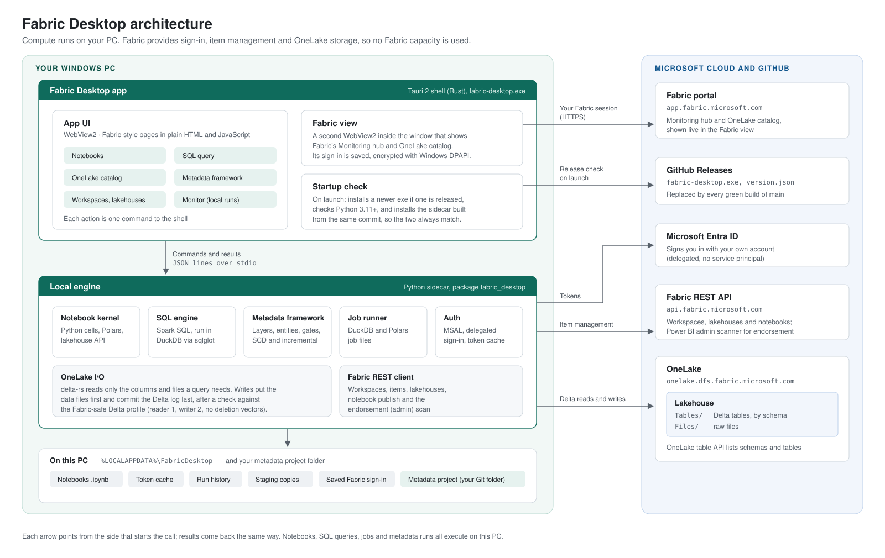

# Fabric Desktop

Do your Microsoft Fabric data engineering on your own Windows PC: notebooks, Spark SQL queries, jobs and a metadata-driven medallion framework. Results are written straight into OneLake as Delta tables, so no Fabric capacity is spent on the transform work.



- **Local compute:** notebooks run in a Python kernel on the PC, SQL runs in DuckDB, and Python transforms run in Polars.
- **Direct to OneLake:** delta-rs writes each table straight to the lakehouse. It commits the Delta log only after the data files are written, so Fabric never sees a half-written version.
- **Fabric-safe tables:** every table is checked against a conservative Delta profile (reader 1, writer 2, classic checkpoints, no deletion vectors or column mapping). This keeps tables readable by the SQL analytics endpoint and Direct Lake.
- **Signs in as you:** the app uses delegated MSAL sign-in, with no service principal. Your token cache lives in `%LOCALAPPDATA%\FabricDesktop`.
- **Fabric's own pages inside the app:** the Monitoring hub and the OneLake catalog are embedded, and their sign-in is kept between launches.

How the pieces fit together, how a request flows and how writes reach OneLake: see [docs/architecture.md](docs/architecture.md).

## Layout

| Path | What it is |
| --- | --- |
| `sidecar/` | Python package `fabric_desktop`: auth, Fabric REST client, OneLake I/O, notebook kernel, SQL engine, metadata framework, job runner and the JSON-lines server |
| `app/` | Tauri 2 shell (`src-tauri/`) and the Fabric-style UI (`ui/`, plain HTML and JavaScript). The shell starts the sidecar and forwards UI actions to it |
| `docs/` | Architecture overview and diagram, and the KratosBI logo files (`docs/brand/`) |
| `examples/` | Sample jobs (`sales_by_region.toml` for DuckDB, `top_products.toml` for Polars) and sample data |

## One-time setup: Entra app registration

1. In the Entra admin center, go to **App registrations > New registration**. Add a **Public client** redirect URI of `http://localhost`.
2. Under **API permissions**, add these delegated permissions:
   - Power BI Service (Fabric): `Workspace.ReadWrite.All` and `Item.ReadWrite.All`.
   - Azure Storage: `user_impersonation`.
3. Copy the Application (client) ID and set it for your user:
   `setx FABRIC_DESKTOP_CLIENT_ID <client-id>`

Your tenant may require admin consent for these permissions.

## Run it

```powershell
cd sidecar
python -m pip install -e ".[dev]"
python -m pytest -q                         # local tests, no Fabric needed
fabric-desktop preview ..\examples\sales_by_region.toml
fabric-desktop sign-in
fabric-desktop run ..\examples\sales_by_region.toml   # set workspace_id in the job first
```

### Desktop app

Download [fabric-desktop.exe](https://github.com/KratosDataGod/fabric-desktop/releases/download/latest/fabric-desktop.exe) from the **Releases** section of the repository page and double-click it. Every green build of `main` replaces it with a fresh copy. Windows SmartScreen may warn because the exe is not signed yet; choose **More info > Run anyway**. The app runs the sidecar with the `python` on your PATH (Python 3.11 or later). To use a different interpreter, set `FABRIC_DESKTOP_PYTHON` to its full path.

Each time it starts, the app checks its components before anything else runs:

- **Fabric Desktop:** if a newer build has been released, it downloads it straight away, checks the file really is that build, replaces the exe in place and restarts. The account menu shows which build is running.
- **Python:** it must be 3.11 or later.
- **Local engine (the sidecar):** the app installs the sidecar from the same commit the exe was built from, with pip, so the two always match. A missing or older sidecar is installed or updated automatically, with pip's output shown while it runs. An editable (`pip install -e`) install is left alone.

Exes you build yourself skip the update check and leave the sidecar as you installed it.

To build it yourself instead, install Rust and the [Tauri prerequisites](https://v2.tauri.app/start/prerequisites/), then:

```powershell
$env:FABRIC_DESKTOP_PYTHON = (Get-Command python).Source   # the Python that has the sidecar installed
cd app\src-tauri
cargo run
```

### Knowing what's running

The top bar holds the **Environment** picker (Dev, Test or Prod), which every page uses, and a pill that says where that environment runs, such as "Runs in Fabric · Sales - Test". Click the pill to change it. **Home** starts with what needs attention (tables whose last run failed, in any environment), then what is running, the next scheduled runs, and each environment's state. The **bell** opens the activity tray: it follows runs in Fabric until they end, even if you leave the page, keeps results you can reopen, and keeps every error with its technical details folded underneath. Errors are explained in a sentence ("Your sign-in expired", "You don't have permission for that in this workspace"); the raw text is under **Details**. **Monitor** lists runs from every environment (Test and Prod once you are signed in), filtered by environment and by where they ran, with failures first and their reason in the row. The Fabric Monitoring hub below it can be hidden.

## Notebooks

The app looks and works like the Fabric service: the same left rail (Home, Create, Workspaces, OneLake, Metadata, Monitor), and Python notebooks with a ribbon, an Explorer pane and **Add data items** to attach a lakehouse. Cells run in a Python kernel on this PC, so no Fabric capacity is used.

**Add data items** opens a OneLake catalog: every lakehouse in every workspace you can open, in one list you can filter, with each lakehouse's tables and files shown before you attach it. The left side filters by Favorites, Endorsed or one workspace. Favorites are the stars you click in the list. They are saved on this PC, because Fabric has no public API for its own favorites. Endorsed (Certified or Promoted) comes from Fabric's admin workspace scan, so it works only when your account is a Fabric administrator and the app registration has the Power BI `Tenant.Read.All` delegated permission with consent. Otherwise the filter is greyed out with the reason.

```python
import polars as pl
from fabric_desktop import lakehouse

sales = lakehouse.read_csv("Files/raw/sales.csv")      # downloaded from the attached lakehouse
by_region = sales.group_by("region").agg(pl.col("amount").sum())
lakehouse.write_table(by_region, "dbo.sales_by_region")  # Delta table written straight to OneLake
```

- `read_csv`, `read_parquet` and `read_json` read `Files/...` paths from the attached lakehouse; any other path is a file on this PC.
- `sql("SELECT ...")` runs Spark SQL over the attached lakehouse's tables on this PC and returns a Polars DataFrame.
- `read_table("schema.table")` and `write_table(df, "schema.table", mode="overwrite" | "append")` work with Delta tables. The schema defaults to `dbo`. Writes are checked against the Fabric-safe Delta profile and show up in **Monitor**. A new table can show under **Unidentified** in Fabric until you refresh the lakehouse there.
- A cell's last expression is shown below it. Data frames (Polars, pandas, Arrow, DuckDB) show as a table of the first 100 rows.
- **Stop** ends the running cell by restarting the kernel, which clears its variables.
- Notebooks autosave as `.ipynb` files in `%LOCALAPPDATA%\FabricDesktop\notebooks`. **Publish to OneLake** also saves the notebook as a notebook item in the attached lakehouse's workspace.

**Run in Fabric** and **Schedule** hand a finished notebook to Fabric. Run in Fabric publishes the notebook, then starts it on the workspace's Fabric capacity with Fabric's job scheduler; the status bar and **Monitor** follow the run until it finishes. Schedule publishes it and adds a Fabric schedule (every day at set times, some days of the week, or every few minutes, in a time zone you pick), so it runs even when this PC is off; the same dialog lists and removes the notebook's schedules. A notebook that uses `fabric_desktop.lakehouse` is published as a Fabric Python notebook with a setup cell first, which defines the same `lakehouse` module from the libraries Fabric's Python notebooks already have (Polars, deltalake, DuckDB), so the notebook runs there unchanged; its `%%sql` cells become `lakehouse.sql(...)`. The setup cell is only in the published copy. Notebooks that don't use the module, such as the surrogate key templates, are published as they are, for Spark.

**OneLake** is the catalog page. The top lists every item in every workspace you can open (lakehouses, warehouses, notebooks, semantic models, reports and the rest). Search matches names, workspaces, types, descriptions and lakehouse table names. Filter by Favorites, Endorsed, one workspace or an item type, and sort by any column. Lakehouse rows expand to show their tables and files, and open in a notebook. **Show in Fabric** opens the item in the bottom half, which is Fabric's own OneLake catalog in the same embedded Fabric view that Monitor uses.

**SQL query** works like Fabric's SQL query tab. Open it from a lakehouse page, or from **SQL query** on a lakehouse row in OneLake. Write Spark SQL against the lakehouse's tables by the names Fabric uses (`SELECT * FROM sales`, or `schema.table`). The query runs on this PC: sqlglot translates it to DuckDB SQL and DuckDB reads only the columns and files it needs from OneLake, so no Fabric capacity is used. Ctrl+Enter runs the query, or just the selected text. Results show the first 1,000 rows. **Save as table** writes the full result to the lakehouse, **Download CSV** saves it to your Downloads folder, and **Open in notebook** turns the query into `lakehouse.sql(...)` in a new notebook. Query tabs are kept per lakehouse between launches. Queries only read; nothing in the lakehouse changes unless you save a table.

**Monitor** has two halves. The top lists what Fabric Desktop ran: metadata runs in Dev, notebook table writes, and the notebook runs and table maintenance jobs it started in Fabric (with their live status), newest first. The bottom is Fabric's own Monitoring hub, the live page from the Fabric service shown in a second webview inside the app window, so Fabric Desktop adds no monitoring code of its own there. That view signs in with your Windows account when it is the same work account you use in the app, so there is no password prompt. It opens in the tenant of your app sign-in, which skips Fabric's email page. If Windows is signed in with another account, Fabric asks you to sign in once. The app saves that sign-in's cookies, encrypted for your Windows account (DPAPI), in `%LOCALAPPDATA%\FabricDesktop\fabric-view-signin.bin` and restores them on the next launch, so you don't sign in again each time. Delete that file to forget the sign-in. Links that leave Fabric open in your default browser.

Fabric Desktop is by [KratosBI](https://kratosbi.com). The KratosBI logo and app icon in `docs/brand/` and `app/ui/` belong to KratosBI. Interface icons are [Fluent UI System Icons](https://github.com/microsoft/fluentui-system-icons) (MIT).

## Metadata framework

**Metadata** in the left rail manages Bronze to Gold (or any 2 to 10 layers) from config instead of one-off notebooks. A metadata project is a folder you keep in Git:

| File or folder | What goes there |
| --- | --- |
| `layers.toml` | Your layers, in order. Each layer is its own schema-enabled lakehouse, `LH_<Layer>`, in every environment. |
| `metadata/entities/<layer>.<table>.toml` | One file per table: source, contract (columns, types, keys), cleaning rules, derived columns, checks, load mode. |
| `transforms/` | Your Python: hooks, custom checks and custom steps. Shared helpers go in `transforms/common.py`. |
| `tests/` | Tests for your Python. Every hook and custom step must name one. |
| `exceptions.toml` | Approved exceptions to a rule, each with a reason, an approver and an expiry. |
| `metadata/keys/<name>.toml` | One file per business key. Each is a key table `sk.<name>` in `LH_Keys`. |
| `metadata/keys/source_systems.toml` | Every source system (fixed id and code) and its connection in Dev, Test and Prod. |
| `environments.toml` | Where Dev, Test and Prod write, and the Keys workspace that holds each one's `LH_Keys`. Dev writes Delta tables to the project's `.local` folder by default. |

Every run goes through the same steps: read, contract (schema drift and types), surrogate keys, clean, derive, hooks, lookups, checks, write, log. Load modes are full, incremental (watermark plus merge on the key), Type 1 dimension and Type 2 dimension. Dimensions get integer surrogate keys that are never renumbered and an Unknown member at -1; facts look up the key that was current on the fact's date.

### Surrogate keys

Surrogate keys are managed in one place: a lakehouse `LH_Keys` in a dedicated Keys workspace per environment (Dev keeps it on this PC). Each business key has its own key table, `sk.<name>`, with three columns: `<name>_sk` (INT), `<name>_bk` (the business key, unique) and `create_date`. Customer ABC gets one key, say 123, and every source that has Customer ABC maps to 123. A table takes its keys with a `[[keys]]` block:

```toml
[[keys]]
table = "customer"
business_key = "customer_id"     # or a list for a composite key, stored as "a||b"
```

The first step of every run MERGEs the business keys it hasn't seen yet into the key table (continuing from the highest key, never reusing one), then adds `customer_sk` to every row. Rows with no business key get -1. A Type 1 dimension whose rows already carry the key uses it instead of issuing its own. **Metadata > Surrogate keys** lists the key tables with their counts and looks up a business key; an entity's page shows the same MERGE in Spark SQL and **Create template notebook** saves a notebook whose first cell is that MERGE, for running in Fabric. Tick **Surrogate keys: Required** on a layer (for example Silver) to make every table in it use them.

**Metadata > Source systems** keeps each source's id, code, type and owner, and its connection per environment: server, port, database, schema, base URL, file path, authentication, tenant, username, Key Vault URL and secret name, Fabric connection id, gateway and extra options. Passwords and keys never go in it. **Sync to LH_Keys** writes them to `config.source_system` and `config.source_connection` so notebooks and pipelines can look up connection values by code; promote does the same and creates any missing key table, but never copies keys between environments.

Four gates keep the rules followed:

1. **Save:** every entity is checked against its layer's standards. Tables can read earlier layers, or their own layer when there's no loop, never a later one. Columns must exist upstream, so renames and deletes show what breaks. Custom code needs an owner and a test.
2. **Write:** checks run before every commit. `stop` writes nothing, `quarantine` moves failing rows to `quarantine.<schema>_<table>` with the reason, `warn` only records it. Only the framework writes a managed table; notebooks get an error and can use `scratch_` tables.
3. **Promote:** Dev to Test and Test to Prod need a clean save gate and a green last run of every table's current logic. Promote creates the `LH_<Layer>` lakehouses and `LH_Meta`, and pins the environment to that metadata version.
4. **After:** `meta.run_log`, `meta.dq_results`, `meta.watermarks`, `meta.schema_history` and `meta.deployments` in `LH_Meta`, plus `_run_id` and `_loaded_at` on every row and the run ID and metadata version on every Delta commit.

When a table's logic changes, an incremental run stops and asks: apply to new rows only, or rebuild the table and everything downstream. Changing a dimension from Type 1 to Type 2 offers a migration that keeps every key.

Where custom logic goes, simplest first: an expression (`[[derive]]` or a `[[check]]` with `expr`), a hook (`[hooks] after_clean` or `before_write`, a `(df, ctx)` function that declares the tables it `reads` and the columns it `adds`), a custom check (`[[check]] python = ...`), or a custom step (`[step] custom = ...`) that replaces one table's transform while the framework still checks and writes the result.

### This PC or Fabric runs each environment

Each environment card in **Metadata > Environments and promote** has **Runs on: This PC | Fabric**, so Dev, Test and Prod can each run in either place (`compute` in `environments.toml`). Fabric needs the environment's tables in OneLake, so a Dev that writes to `.local` runs on this PC until you point it at a workspace.

With Fabric, **Run all** (and running one entity, backfills and rebuilds) uploads the metadata project and this app's engine to `LH_Meta/Files/_fabric_desktop/current` and starts one notebook in the workspace, `nb_fabric_desktop_runner`, a Fabric Python notebook that runs the same engine against the same lakehouses. The upload is skipped when nothing changed. The app follows the job and shows the results when it finishes; the run log, checks and quarantine land in the same `LH_Meta` tables, so **Runs**, promote and table health don't care where a run happened. The runner fails its Fabric job when a table fails, so Fabric's Monitoring hub shows it too. **Schedule** adds Fabric schedules that run every entity, even when this PC is off, from the project as it was last uploaded; promoting to an environment that runs in Fabric uploads the new version.

Changing settings in `environments.toml` no longer changes the metadata version, so after updating to 0.6.0 promote each environment once to pick up the new version number.

### Profile, table health and the semantic model

**Profile** on an entity's page reads what the entity reads, every row, on this PC, before any cleaning: nulls, distinct values, ranges and lengths, the most common values, and what looks wrong. It turns what it finds into rules the framework already runs: `[[clean]]` blocks to trim spaces, turn values like `N/A` into nulls, fold `Shipped`/`SHIPPED` into one case or parse dates stored as text, and `[[check]]` blocks for not null, unique, accepted values and ranges (warn by default, stop for the table's own key). Tick cleaning rules to see the rows they change before and after, then **Add to entity** appends the ticked blocks to the entity file through the save gate. Problems a rule already handles are marked as handled and not suggested again. **Profile its table instead** profiles what the entity wrote, for checks.

**Metadata > Table health** reads every managed table's Delta log in the chosen environment: files, size, average file size, versions since the last VACUUM, the last OPTIMIZE and whether the files are V-Ordered, with advice for each. In Test and Prod (OneLake), **Optimize** runs Fabric's table maintenance job on the workspace's capacity: OPTIMIZE with V-Order, which Direct Lake and the SQL analytics endpoint read fastest, then VACUUM keeping 7 days. Tables written from this PC have no V-Order until it runs, so by default every table a Test or Prod run writes is optimized right after the run; untick **Optimize every table a run writes** to turn that off for an environment (`optimize_after_run` in `environments.toml`). In Dev, **Compact** does the same on this PC with delta-rs, without V-Order.

**Metadata > Semantic model** builds a Direct Lake semantic model over a layer's tables (the last layer, usually Gold) in Test or Prod. It reads the layer's lakehouse through its SQL analytics endpoint, with no import and no refresh schedule. Each entity is a table, facts get a row count measure, and relationships come from the metadata: a fact's `[[lookup]]` names the dimension and its key, and any other column named like a dimension's surrogate key joins to it. Surrogate keys, `_run_id` and `_loaded_at` are hidden. **Create model** creates `SM_<Layer>` in the environment's workspace (you can rename it); building again updates it in place and keeps every lineage tag, so reports on it keep working. The app asks the SQL endpoint to pick up new tables first.

## Job files

```toml
name = "sales_by_region"
engine = "duckdb"            # or "polars" with script = "file.py" defining transform()
sql = "select region, sum(amount) as total from read_csv_auto('data/sales.csv') group by region"

[target]
workspace_id = "<workspace guid>"
lakehouse = "Sales"          # created as a schema-enabled lakehouse if missing
schema = "dbo"
table = "sales_by_region"
mode = "overwrite"           # or "append"
```

Relative paths in a job resolve from the job file's folder.

## Not yet built

A bundled Python runtime and installer, and pipelines. From the metadata plan: per-step performance suggestions, re-pointing -1 facts when a late customer arrives, replaying quarantined rows, and running hook tests on promote. Source system connections are a table in `LH_Keys`, not yet a Fabric variable library item.
